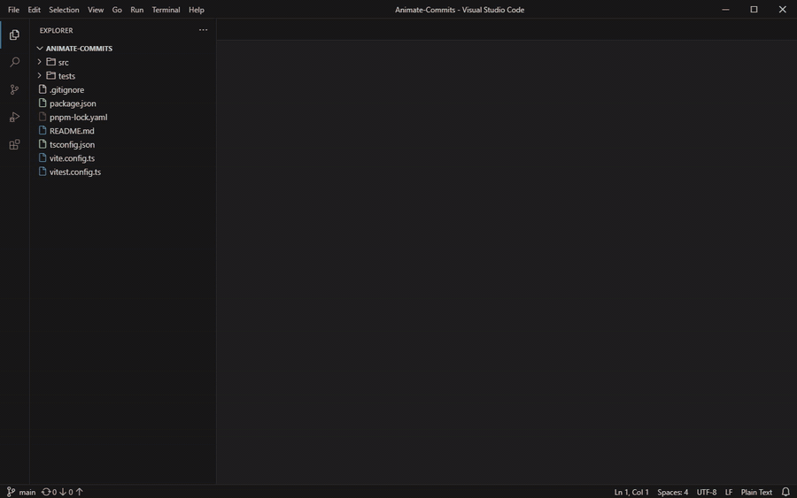

# animate-commits

Animate a git commit — or a range of commits — as if it were being written in VS Code, using your
current VS Code theme.



*15-second excerpt from `4a05e3a` — the commit that added the VS Code renderer — replayed at 10×.*

`animate-commits` reads a repository's history, replays each change as real editor activity (opening
files, typing, deleting, renaming, saving), and renders the result as an MP4 or a scrubbable browser
preview. The window, colors, fonts, title bar, Explorer, and Source Control view are recreated from
your VS Code installation and settings. Nothing is written to your repository or your VS Code
settings.

## Requirements

- Node.js 20+
- pnpm
- git
- a local VS Code installation (used for its color themes, TextMate grammars, and settings)
- ffmpeg and a Chromium-based browser (Chrome, Edge, or Chromium) for MP4 export

Check everything at once:

```bash
pnpm install
pnpm build
node dist/cli.js doctor
```

`node dist/cli.js themes` lists the themes found in VS Code and shows the active one.

## Quick start

Animate one commit:

```bash
node dist/cli.js render /path/to/repo --commit HEAD --out out/head.mp4
```

Animate a range, oldest first, including the Source Control commit flow:

```bash
node dist/cli.js render /path/to/repo --range HEAD~3..HEAD --scm --out out/range.mp4
```

Preview the same timeline in your browser with playback and scrubbing:

```bash
node dist/cli.js preview /path/to/repo --commit HEAD --scm --open
```

On Windows the built CLI is plain Node, so `node dist/cli.js` works from any shell. If you install
the package, the `animate-commits` binary is the same entry point.

## Demo

Generate a small demo repository with three commits (add a project, rename a file, delete a file,
and edit code) under `out/demo-repo`:

```bash
pnpm demo
```

Then render the history:

```bash
node dist/cli.js render out/demo-repo --range main~3..main --scm --out out/demo.mp4
```

## What the animation includes

- **Typing** — per-character insertions with deterministic jitter, Backspace/selection deletions,
  scrolling to each hunk, and a blinking cursor. Low-level diffing keeps unchanged text in place and
  only edits the bytes that changed.
- **Tabs** — files open in preview tabs (italic), become permanent when edited, show a dirty dot
  while unsaved, and close when deleted.
- **Explorer** — an optional trackable file tree with git decorations while a commit is in progress.
  Turn it off with `--no-explorer`; files are then opened through quick open instead.
- **File operations** — new files, deletions (with the VS Code confirmation dialog), and renames or
  moves. When the Explorer is hidden or a folder is collapsed, the step temporarily reveals and
  expands the tree, then restores the previous sidebar state.
- **Source Control** — optional SCM view with staged changes, a typed commit message, the commit
  action, and a `Committed <sha> — <subject>` notification.
- **Window chrome** — Windows, macOS, or Linux title bars: `--titlebar windows|macos|linux`.
- **Your theme** — workbench colors and TextMate token colors resolved from the active VS Code theme,
  including themes that `include` a base theme or live in extensions.
- **Your fonts** — editor font family, size, line height, ligatures, minimap visibility, and tab size
  come from VS Code settings, including workspace settings and language-scoped overrides.

## Options

Options shared by `render` and `preview`:

| Option | Default | Description |
| --- | --- | --- |
| `--commit <rev>` | — | Animate a single commit |
| `--range <range>` | — | Animate a git range, oldest first (`A..B` excludes A) |
| `--vscode <path>` | auto | Path to the VS Code installation |
| `--theme <label\|path>` | active theme | Theme label or path to a theme JSON file |
| `--editor-font <family>` | VS Code setting | Override the editor font stack |
| `--ui-font <family>` | platform default | Override the window/UI font stack |
| `--titlebar <platform>` | host | `windows`, `macos`, or `linux` |
| `--title <text>` | derived | Explicit window title |
| `--no-explorer` | Explorer on | Hide the Explorer and open files via quick open |
| `--scm` | off | Show the Source Control commit flow |
| `--merges` | off | Include merge commits (diffed against the first parent) |
| `--ignore <glob>` | — | Exclude paths from the animation (repeatable) |
| `--speed <x>` | `0.6` | Timing multiplier; `0.6` is slower, `2` is twice as fast |
| `--typing <ms>` | `42` | Base delay per typed character |
| `--max-typed <n>` | `1200` | Characters typed per commit before bulk insertion |
| `--instant` | off | Insert changes without per-character typing |
| `--seed <n>` | derived | Seed for deterministic typing jitter |
| `--intro <ms>` | `700` | Pause before the first action |
| `--hold <ms>` | `1400` | Pause on the final frame |
| `--max-duration <seconds>` | `0` (off) | Explicit safety cap; overrides `--speed` if the timeline runs longer |
| `--max-file-lines <n>` | `4000` | Files longer than this are shown as status-only changes |
| `--max-tabs <n>` | `8` | Maximum open editor tabs |

`render` adds:

| Option | Default | Description |
| --- | --- | --- |
| `--out <file>` | `out/<repo>-<sha>.mp4` | Output MP4 |
| `--fps <n>` | `20` | Frame rate |
| `--size <WxH>` | `1280x800` | Window size in CSS pixels |
| `--scale <n>` | `1` | Device pixel ratio of the capture |
| `--frames <dir>` | — | Write PNG frames instead of an MP4 |
| `--ffmpeg <path>` | PATH | ffmpeg executable |
| `--browser-exe <path>` | auto | Chromium-based browser executable |
| `--capture-all` | off | Capture every frame even when the visible state is unchanged (debugging) |
| `--dump-scene <file>` | — | Write the generated scene JSON |

`preview` adds `--open`.

### Pacing

- **`--speed`** is the pacing control applied by default. `0.6` is slower than real time; `--speed 1`
  restores the original pacing and `--speed 2` halves the duration.
- **`--max-duration`** is off by default. When you pass it, the whole timeline is compressed to fit,
  which can raise the effective speed above `--speed`; the CLI prints a warning with the effective
  multiplier. It never kicks in on its own.
- **`--max-typed`** caps character-by-character typing per commit. Past that point the remaining
  lines are inserted in bulk, which is a deliberate change of pace for very large diffs. Raise it for
  more typing, lower it for shorter videos, or use `--instant` to skip typing entirely.
- The preview's 0.5×–4× selector changes playback only; it does not alter an exported video.

## How it works

1. **Read history.** Commits are resolved with `git rev-list`, changes with
   `git diff --name-status -M`, and file contents with `git cat-file`. Root commits diff against the
   empty tree; merge commits are skipped unless `--merges` is passed.
2. **Resolve VS Code.** The active color theme is looked up in the installed built-in and user
   extension themes, including localized label keys and `include` chains. Workbench colors, token
   colors, fonts, tab size, and minimap settings are merged from defaults, user settings, and the
   repository's `.vscode/settings.json`.
3. **Plan the edits.** A line diff and character-level refinement produce explicit cursor,
   insertion, and deletion operations. Every plan is replayed against the old contents and verified
   against the new contents before rendering.
4. **Build a scene.** The scene is a JSON timeline of events (open file, scroll, edit, save, rename,
   delete, stage, commit, toast) with deterministic timing. The browser renderer is a pure function
   of time: `window.__seek(tMs)` draws exactly that frame. No CSS animations are used.
5. **Render.** A loopback server serves the renderer, scene, and TextMate grammars. Headless
   Chromium seeks frame by frame, and each frame is fingerprinted from the visible state; frames
   whose state did not change are reused instead of captured again, which keeps holds and
   inter-keystroke frames cheap. Captures are piped into ffmpeg and the result is an H.264 MP4.

Syntax highlighting uses the TextMate grammars already installed in VS Code (built-ins plus your
extensions), so languages beyond the common ones work without bundling grammars in this project.

## Self-animation

Because the tool is a normal git repository, it can animate its own creation. Exclude the lockfile
(which is not worth typing out) and keep the video short:

```bash
node dist/cli.js render . --range <first-sha>..HEAD --ignore pnpm-lock.yaml \
  --speed 2 --max-duration 120 --out out/creation.mp4
```

## Limitations

- The window is a high-fidelity **simulation**, not a recording of a real VS Code process. Pixel
  metrics can differ slightly by platform and installed fonts.
- Semantic highlighting from language servers is not used; colors come from TextMate token rules.
- The terminal, debugger, diff editor, git graph, and extension views are not implemented.
- Very large or binary files, symlinks, and submodules are shown as Source Control changes but not
  typed.
- Themes that derive colors programmatically rather than listing them may show fallback colors for
  uncommon UI keys.
- The tool needs a VS Code installation for full fidelity. With `--theme <path>` it can run without
  one, but syntax highlighting then falls back to plain text.

## Troubleshooting

- **"Renderer assets not found"** — run `pnpm build` first.
- **VS Code not found** — pass `--vscode "C:\...\Microsoft VS Code"` or `--theme <theme.json>`.
- **Unknown theme** — `node dist/cli.js themes` lists installed labels.
- **No browser** — install Chrome/Edge or pass `--browser-exe`. `pnpm exec playwright install
  chromium` also works.
- **ffmpeg missing** — install it and make sure it is on PATH, pass `--ffmpeg`, or use `--frames`.
- **Fonts look different** — install the font configured in `editor.fontFamily`, or override with
  `--editor-font`.

## Development

```bash
pnpm typecheck     # TypeScript
pnpm test          # unit, git fixtures, scene replay, renderer state
pnpm test:motion   # builds the renderer and verifies real screenshots change
pnpm build         # bundle the CLI and renderer into dist/
```

Tests create throwaway git repositories in the OS temp directory; they never touch your projects.

## Credits

Window icons come from [`@vscode/codicons`](https://github.com/microsoft/vscode-codicons). Syntax
highlighting runs on [`vscode-textmate`](https://github.com/microsoft/vscode-textmate) with
[`vscode-oniguruma`](https://github.com/microsoft/vscode-oniguruma). Theme and grammar files are read
from the local VS Code installation and are not redistributed here.
